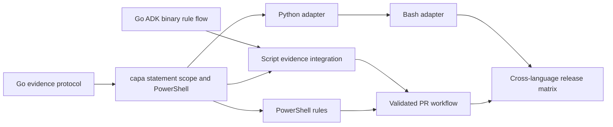

# capa Script Analysis and Rule Agent Roadmap

> **For agentic workers:** REQUIRED SUB-SKILL: Use superpowers:subagent-driven-development (recommended) or superpowers:executing-plans to implement this plan task-by-task. Steps use checkbox (`- [ ]`) syntax for tracking.

**Goal:** Deliver one project that adds structural PowerShell, Python, and Bash analysis to capa and uses that evidence in a Go ADK rule-generation workflow.

**Architecture:** The Go Tree-sitter companion executable emits a bounded, versioned evidence document; a thin Python capa adapter matches script rules through a new `statement` scope. A separate Go ADK agent consumes capa evidence or binary-analysis results and opens reviewable rule PRs only after deterministic validation.

**Tech Stack:** Go 1.25+, Tree-sitter Go bindings and pinned grammars, capa Python 3.10+ adapter, Google ADK Go v2, Gemini API, YAML rules, GitHub API/Actions.

**Spec:** [2026-10-22-capa-script-analysis-rule-agent-design.md](../specs/2026-10-22-capa-script-analysis-rule-agent-design.md)

## Global Constraints

- PowerShell is first, Python second, Bash third.
- Go owns new parsing/extraction and agent orchestration; Python is limited to capa's existing integration boundary.
- Samples and model output are never executed. Raw source upload to Gemini is off by default.
- GitHub maintainers retain merge control; only validated, reviewable rule PRs may be submitted.
- Preserve capa's Python `>=3.10` support and existing binary/dynamic behavior.

## Review Focus

- A malicious or malformed script cannot become a shell command in the parser or validator: covered by backend Tasks 2/6 and agent Tasks 6/8.
- Two statements at the same source offset cannot merge unrelated evidence: covered by backend Tasks 2/4/5.
- An old freeze/result document must remain readable after introducing script features: covered by backend Task 8.
- A rule may pass the linter yet match no real positive or match a benign negative: covered by agent Tasks 7/9 and backend Task 9.
- Retried events or repeated scheduled runs must not create duplicate PRs: covered by agent Tasks 3/4/11.

---

## Plan set and order

1. [Native script backend plan](2026-10-22-capa-native-script-backend.md): contracts, PowerShell vertical slice, Python and Bash adapters, rules, CI, packaging. Its PowerShell slice is independently useful through `capa`.
2. [Rule agent plan](2026-10-22-capa-go-rule-agent.md): binary-rule flow first, then script evidence integration, feeds, PR publication. Its binary-rule path is independently useful before script support lands.

Run backend Tasks 1–8 before agent Task 5 consumes script evidence. Agent Tasks 1–4 can proceed while the backend is developed. Publish `capa` engine changes before merging rules that use new `statement` or script features; pin compatible engine/rules revisions in agent integration tests. The dependency diagram is:

## Cross-repository delivery gates

- **Gate 1 — PowerShell:** `capa -f powershell` produces source-located features and a rule match; a malformed sample is bounded; old PE/ELF/.NET tests pass.
- **Gate 2 — Agent:** a recorded binary rule idea reaches a dry-run PR package with a genuine positive, negatives, formatter/linter/test logs, and no network/model calls in unit tests.
- **Gate 3 — Combined:** the agent consumes a PowerShell capa result, proposes a script rule, and passes the same deterministic gates before a human reviews a PR.
- **Gate 4 — Coverage:** Python then Bash reach the same tests, freeze/result round trips, packaging, and documented corpus evaluation.

Each repository uses its own branch and PR. Changes to the `rules` submodule pointer in capa happen only when the corresponding capa-rules revision is available. The local `.env` remains ignored and is never included in commits or test artifacts.

## Skill use during execution

- Use Superpowers `using-git-worktrees` before implementation, `test-driven-development` for each plan task, `systematic-debugging` for failures, and `verification-before-completion` plus `requesting-code-review` at each release gate. This roadmap and both task plans were prepared with `brainstorming` and `writing-plans`.
- Use the installed Jeffallan-authored `architecture-designer` and `api-designer` skills for scope and evidence contracts; `golang-pro` for the parser and agent; `python-pro` only for the thin capa adapter; `prompt-engineer`, `security-reviewer`, `test-master`, and `devops-engineer` for the model boundary, intake/PR controls, corpus, and packaging/CI. Apply capa's repository conventions and Python `>=3.10` floor over skill defaults.
- The device has an empty `awesome-design-md` directory with no usable `SKILL.md`, and no skill literally named `jefflan`; the Jeffallan-authored skills above provide the relevant guidance.
