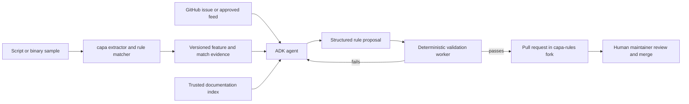

# capa Native Script Analysis and Rule Agent: Design

Date: 2026-10-22
Status: proposed for user review

## Intent

Deliver one end-to-end, upstream-ready capa capability: analyze scripts structurally, use the resulting evidence to draft useful capa rules, verify those rules against the official tooling and sample corpus, and prepare pull requests for human maintainers. The language delivery order is PowerShell, Python, then Bash. The rule agent also handles ordinary capa rule ideas and binary samples; script support is an additional evidence source, not a separate agent.

The user wants the full scope without a 350-hour cap and will use hosted Gemini through an API key in the local `.env`. No self-hosted model is required.

## Current state and constraints

- The planning workspace is now a checkout of `mandiant/capa` at `2bdf7a47` on `master`, with `rules` checked out as a submodule at `21332a05` and test data not initialized. It contains `.env`, which is ignored by `.gitignore`; the key must never be printed, copied into a document, or committed. The repository requires Python `>=3.10`, and the implementation must preserve that floor unless maintainers explicitly approve changing it.
- capa separates engine code, rules, and test data. The current `StaticFeatureExtractor` exposes file, function, basic-block, and instruction traversal. The static matcher aggregates features through those levels. The rule format has the same static scopes; there is no source statement scope today. Script support therefore reaches the extractor, matcher, rule schema, rendering, input detection, and test harness, rather than a parser module alone.
- `FileOffsetAddress` already represents byte offsets and can anchor source evidence. A source line/column is a rendered projection of the byte offset, not a replacement address type.
- Rules and capa major versions must be compatible. A rule using a new script feature cannot be treated as valid against an older engine merely because its YAML parses.
- Tree-sitter produces a concrete syntax tree with error recovery. Parsing is structural, but it is not evaluation, data-flow analysis, or proof of runtime behavior. The system must report uncertainty around dynamic invocation, imports, aliases, interpolation, and obfuscation.
- PowerShell's older Microsoft Tree-sitter repository is archived. Start with a compatibility and coverage assessment of the maintained `wharflab/tree-sitter-powershell` grammar and its Python wheels before selecting a pinned release. Python and Bash use the official Tree-sitter grammars if they pass the same assessment.
- GitHub issues and feeds are untrusted input. Samples are never executed by the analysis or validation loop. Model output is a proposal, never an instruction to run code.

## Goals

1. Support native `capa` CLI and Python-library analysis of PowerShell, Python, and Bash source files, with explicit format selection and conservative auto detection.
2. Extract reproducible, source-located features for calls, variable reads/writes, literals, and control or syntactic structures, with a documented normalization contract for each language.
3. Add script-appropriate rule semantics without pretending that AST blocks are binary control-flow basic blocks. Preserve behavior for PE, ELF, .NET, and dynamic reports.
4. Provide representative script rules with real, provenance-tracked positive examples, benign and adversarial negative examples, and end-to-end matches.
5. Build a separate Google ADK agent that ingests GitHub rule-idea issues, analyst-supplied samples, and scheduled approved feeds; retrieves trusted documentation; drafts structured rule proposals; verifies them; and prepares reviewable PRs to `capa-rules`.
6. Make every proposed rule traceable to source evidence, tool versions, test results, issue/feed provenance, and an audit trail. Maintainers retain merge control.

## Non-goals and anti-goals

- No execution or emulation of submitted scripts, shell commands, downloaded payloads, or LLM-generated code.
- No promise to fully deobfuscate scripts, resolve arbitrary aliases or imports, or prove network/process behavior from syntax alone.
- No rule publication based only on a model assertion or a passing YAML parse.
- No unattended merge, direct push to upstream protected branches, or automatic change to an existing rule without a separately reviewed path.
- No universal language abstraction that erases PowerShell case-insensitivity, Python import/attribute behavior, or Bash command/expansion behavior.
- A parser crash, timeout, huge file, or partial tree must produce a bounded diagnostic and no unsupported high-confidence feature, never silently misclassify content.

## Approaches considered

### A. One capa fork containing parser and agent

One checkout and release path would simplify local wiring. It would also place Gemini credentials, issue/feed scheduling, and GitHub write permissions inside the core analyzer and increase review and dependency burden for users who only want capa. Not selected.

### B. One project across three repositories (selected)

Put parsing, feature extraction, and rule schema changes in `capa`; put reviewed rules and examples in `capa-rules` and the appropriate test-data repository; put ADK orchestration in a separate `capa-rule-agent` package. A pinned integration matrix joins them. This preserves capa as a deterministic analyzer while letting the agent evolve independently. The cost is explicit compatibility management across repositories.

### C. External AST scanner that emits YAML or frozen features only

This could demo quickly but would leave native CLI detection, first-class locations, scope semantics, and long-term engine compatibility unresolved. Rejected because it does not meet the native support goal.

## Architecture

### 1. Source backend in capa

Add script formats (`powershell`, `python`, `bash`) and a `tree-sitter` backend, connected to input classification, CLI choices, loader selection, metadata, and library access. Auto detection uses shebangs, known extensions, and conservative content checks; explicit `--format` overrides ambiguous input. It must never classify an existing supported binary as script based on an extension alone. Grammar dependencies are pinned and lazily loaded so ordinary binary analysis does not require all language wheels at import time. A documented optional extra is acceptable if upstream maintainers prefer it.

Parsing operates on bytes with defined encoding handling, size/time limits, and diagnostics for Tree-sitter `ERROR`/missing nodes. Each language adapter owns node queries, name resolution that can be justified statically, normalization, and extraction. A common intermediate `ScriptEvidence` record contains language, feature kind/value, byte span, containing function or top-level region, confidence/qualification, and the source node category. Only deterministic, supported evidence is converted into capa features. Raw source and speculative LLM interpretation never enter the feature extractor.

Use `FileOffsetAddress` for the start byte of the relevant source node and preserve span plus line/column in optional source-layout metadata or an evidence sidecar. Top-level code is a distinct synthetic region; nested function bodies are not counted twice. Static functions map to actual script functions where present, and top-level statements map to a synthetic module/script function. File-scope aggregation still works. Do not label a lexical block a binary basic block.

The selected rule contract adds a source `statement` static scope and script feature types for call, variable access, and structure, with literals reusing existing string/number types where valid. The source statement scope contains one command/call/assignment or control statement with its directly attached features, and aggregates into function then file scope. Script rules must declare an explicit script format feature to avoid cross-language name collisions. Existing binary `instruction`/`basic block` scopes retain their current meaning. The implementation plan must include rule parser, feature support tables, matcher aggregation, frozen/result serialization, linter, renderers, and tests for the new scope and features. If upstream maintainers reject a new scope, revisit this design with the user and maintainers; do not silently reuse `basic block`.

Language contracts:

- **PowerShell:** case-fold command/variable identifiers according to PowerShell semantics; preserve displayed spelling in evidence; recognize direct cmdlet/function calls, pipelines, member calls when statically identifiable, variable reads/writes, assignments, and control nodes. Resolve only aliases proven by the script or a pinned built-in table. Treat invocation operators, dynamic strings, splatting, and encoded commands as limited or unknown unless decoded by deterministic, bounded logic with provenance.
- **Python:** distinguish direct names from qualified calls and imported aliases; track local import bindings only where unambiguous; extract calls, attribute access, variables, literals, definitions, and branch/loop/try structures. Do not infer runtime targets for reflection, monkey-patching, or dynamic imports.
- **Bash:** distinguish commands, shell functions, variables, assignments, redirections, pipelines, substitutions, and control structures; account for quoting and expansion. Do not equate arbitrary computed command strings with direct commands.

### 2. Rules and samples

Create small library rules for stable script idioms and a capability rule set spanning download, execution, persistence, discovery, and exfiltration patterns where evidence supports them. A rule is about a capability, not a malware family label. Each rule records format, source scope, rationale, example hash/offset, provenance, and known limits. The corpus starts with synthetic fixtures and publicly accessible, provenance-tracked script samples. Put real samples in `capa-testfiles` only when their redistribution rights and maintainer acceptance are confirmed. Private samples remain local and are referenced by hash only in private evaluation; they cannot be the sole evidence for an automated public PR. No sample is committed merely because it appeared in a feed. Test each rule against at least one real positive and several benign/adversarial negatives; use synthetic fixtures for exact parser edge cases. If an eligible public real example cannot be obtained, hold the rule for manual review or nursery consideration instead of presenting it as fully verified.

### 3. Rule agent

Build the ADK package with thin trigger adapters and a deterministic validation worker. Reactive intake reads labeled/allowlisted `capa-rules` issues and permitted attachments; proactive intake runs daily over an explicit feed allowlist with deduplication and provenance checks. The initial public feed adapter supports RSS/Atom and JSON feeds configured by the operator, and the scheduled demonstration includes a read-only scan of new public capa rule-idea issues plus a fixture-backed public threat-report feed. No default adapter downloads raw attachments or payloads. Operators may enable additional feed URLs and attachment MIME types through reviewed configuration, not model-selected URLs. Manual CLI intake accepts a local file or existing capa result. Both paths normalize to a versioned `RuleRequest` containing source links, hashes, desired capability, sample references, permissions, and candidate evidence. The agent can also draft rules for already supported binary features.

Gemini receives an allowlisted evidence bundle and optional retrieved official API/command documentation, not ambient filesystem access. Source text transmission is configurable and off by default. The local `.env` supplies `GEMINI_API_KEY`; production uses a secret store. Never log keys or full private samples. Use structured model output for rule intent, evidence citations, candidate YAML fields, and uncertainty. The agent is instructed to treat issue text, sample strings, and retrieved pages as data; tools enforce that boundary. It cannot call an unrestricted shell, edit arbitrary files, or choose validation commands.

The validator writes a candidate into an isolated working tree, checks rule schema/version and source evidence, runs capa's formatter and official linter (including thorough mode when examples are available), executes capa/rule tests against pinned positive and negative samples, checks duplicate/overlapping rules, and records exact commands, versions, logs, and matches. Failure feedback is parsed into typed errors and sent to a bounded repair loop. Repeated failures, absent legal sample access, poor evidence, or uncertain semantics end in a draft report for human triage, not an auto-submitted PR. A model cannot mark its own tests passed.

The PR publisher creates a branch in a designated fork, writes only validated rule files and permitted test artifacts, and opens a PR with the issue/feed link, sample hashes and sharing status, rule logic explanation, parser/engine/rules versions, positive and negative results, linter output summary, uncertainty, and required maintainer decisions. Idempotency keys prevent duplicate PRs. Human maintainers own final merge and any exception to a failed gate.

### 4. Integration and release boundaries

Version the `ScriptEvidence`/`RuleRequest` interchange schemas and pin compatible capa, grammar, rules, and agent revisions in an integration lockfile. Run a compatibility matrix against supported Python versions and operating systems. The capa backend can ship before the agent and the agent can continue generating binary rules while script languages roll out. Script rules only become eligible for the standard ruleset after their required engine version is released or compatibility is explicitly documented.

## Validation and acceptance

- The first vertical slice is PowerShell: a `.ps1` file goes through `capa`, yields source-located deterministic features, matches a script rule, and supplies cited evidence to an agent-generated candidate that passes linter and sample tests in a dry-run PR package.
- For each language, golden AST/feature fixtures cover direct and qualified calls, variables, literals, structures, encoding, malformed source, ambiguity, and benign lookalikes. The corpus includes real positives and benign negatives with source provenance. Each rule must match every recorded positive and no recorded negative before PR eligibility. Held-out precision/recall and parse-error rates are reported, with thresholds set from a measured baseline and approved by maintainers before broad rule rollout.
- Existing binary and dynamic test suites pass unchanged. New script formats survive freeze/result round trips and render locations correctly. Explicit and auto format selection are tested against spoofed extensions and binary files.
- Agent replay tests use recorded, scrubbed issues/evidence and a fake model to verify tool boundaries, structured output, retry ceilings, idempotency, logging, and PR gating. Live Gemini runs are separately budgeted and evaluated for rule quality; deterministic tests must not require an API key.
- A security review covers untrusted issue/feed/sample content, prompt injection, archive/path traversal, resource exhaustion, credential handling, outbound sample policy, and restricted GitHub permissions. No malicious sample is executed during tests.
- Deployment documentation covers local setup with `.env`, dry-run mode, CI/scheduled operation, grammar upgrades, rule authoring, sample provenance, and manual review/rollback.

## Delivery sequence and dependencies

1. Confirm upstream interface choices with maintainers; inventory current tests, versions, sample handling, and PowerShell grammar coverage. Record the source-scope and feature-vocabulary decision.
2. Land the common script format, source address, feature, and matcher contract with compatibility tests.
3. Deliver the PowerShell extractor and real sample rules as the first end-to-end vertical slice.
4. Add the agent's manual/reactive path, deterministic validator, dry-run PR package, then restricted PR publication.
5. Add Python through the same contract, then Bash, each with language-specific corpus and rules.
6. Add scheduled feeds and operational controls after manual/reactive quality gates have evidence. Run cross-repository compatibility and final security/quality review.

Each phase should produce a reviewable, independently testable change. The later implementation plan will give exact files, interfaces, tests, commands, and PR boundaries.

## Skill use on this device

- **Superpowers:** `brainstorming` for this design, `writing-plans` after approval, then `test-driven-development`, `systematic-debugging`, `verification-before-completion`, and `requesting-code-review` during implementation. Use `using-git-worktrees` when real checkouts exist. The user has requested a plan, so no implementation skill is invoked yet.
- **Jeffallan-authored installed skills:** `architecture-designer` for ADRs and cross-repository interfaces; `python-pro` for typed extractors and agent code; `api-designer` for evidence schemas; `prompt-engineer` for structured outputs and adversarial prompt evaluation; `test-master` and `code-reviewer` for acceptance design; `security-reviewer` for the intake/validation/PR attack surface; `devops-engineer` for scheduled CI and secrets. Apply their guidance where it fits capa's own conventions rather than introducing incompatible tooling or its default Python `>=3.11` assumption.
- **Awesome skills:** an `awesome-design-md` directory exists but has no `SKILL.md`, so it offers no usable workflow. The broad `fullstack-dev-skills` package is present but is less specific than the skills above. No skill literally named `jefflan` was found; the relevant author metadata identifies Jeffallan.

## Open builder decisions

The builder may choose internal module names, parser query layout, and data storage technology for the agent's small audit/idempotency state, provided the behavior and interfaces above hold. The plan should target the public `statement` scope selected above. Maintainer review must confirm that design and select a grammar release that meets the PowerShell corpus; a rejection returns the affected portion to design review rather than inviting an undocumented fallback. The initial corpus and feed choices above are design defaults, not claims that a specific third-party sample or feed is already licensed or approved.

## Primary references

- [2026 FLARE project ideas](https://github.com/mandiant/flare-gsoc/blob/2026/doc/project-ideas.md)
- [capa static extractor contract](https://github.com/mandiant/capa/blob/master/capa/features/extractors/base_extractor.py), [static matcher](https://github.com/mandiant/capa/blob/master/capa/capabilities/static.py), [rule parser and scopes](https://github.com/mandiant/capa/blob/master/capa/rules/__init__.py), [loader](https://github.com/mandiant/capa/blob/master/capa/loader.py)
- [capa rule format](https://github.com/mandiant/capa-rules/blob/master/doc/format.md), [rule contribution guide](https://github.com/mandiant/capa-rules/blob/master/.github/CONTRIBUTING.md)
- [Tree-sitter Python bindings](https://github.com/tree-sitter/py-tree-sitter), [PowerShell grammar candidate](https://github.com/wharflab/tree-sitter-powershell), [Python grammar](https://github.com/tree-sitter/tree-sitter-python), [Bash grammar](https://github.com/tree-sitter/tree-sitter-bash)
- [Google ADK Python](https://github.com/google/adk-python), [capa script support issue](https://github.com/mandiant/capa/issues/2988)
